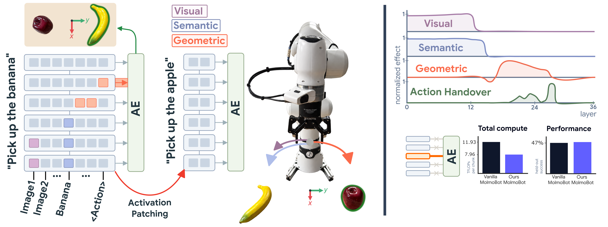
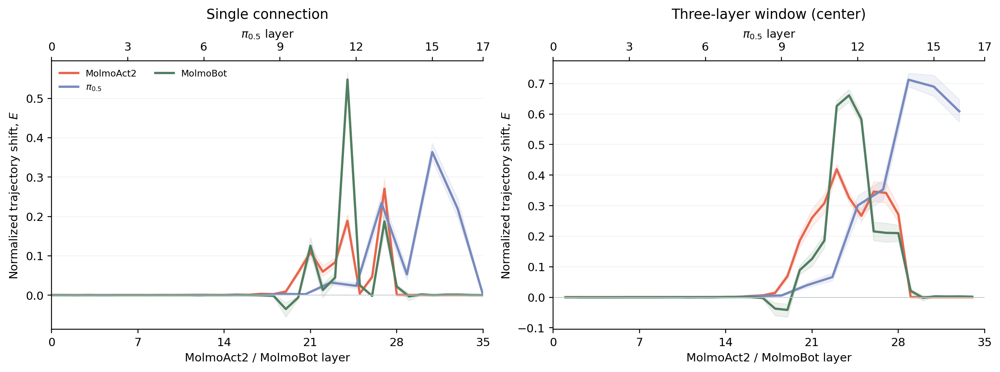
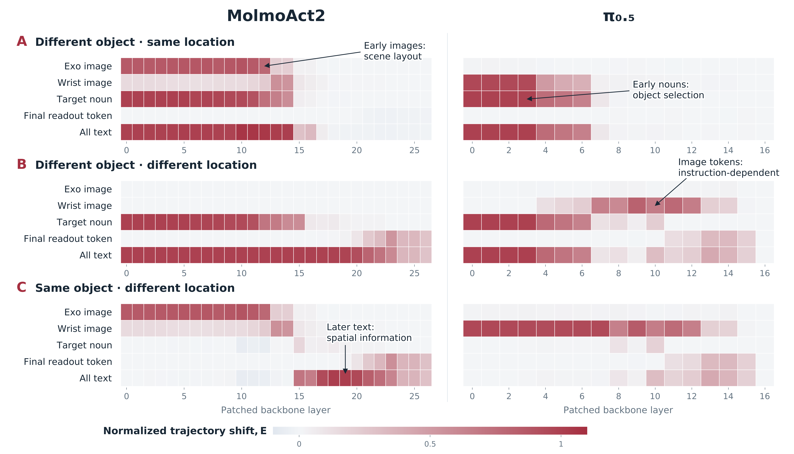

# Causal Analysis of Robot Foundation Models Enables Efficiency Gains

*We copy activations from a donor episode ("Pick up the banana") into a recipient episode ("Pick up
the apple") in which the two objects have swapped places, and measure where the robot then reaches.
Visual information (purple) sits in early image tokens, semantic information (blue) in the early
noun token, and geometric information (orange) in later text tokens. The action expert (AE) reads
from a narrow band of layers. Keeping only this interface in MolmoBot (3 of 36 connections) cuts
compute by 33% with comparable success in simulation (46.7% vs. 46.9%).*

## Main results

### The action expert reads from a narrow band of layers

We patch the connections between the VLM and the action expert one at a time (left) and in windows
of three (right). In every model, one to three adjacent middle-to-late layers have a majority of the influence; we call
this band the **action-conditioning interface**.

### Information changes form as it moves through the backbone

Patching token groups inside the VLM shows what each position carries at each depth. The early target 
noun carries which object to pick and later text tokens carry where to reach.

## License

MIT (see `LICENSE`). `data/robot/franka_droid_kinematics.xml` is derived from the MolmoSpaces
`franka_droid` model and remains under Apache-2.0 (see `data/robot/LICENSE`).
